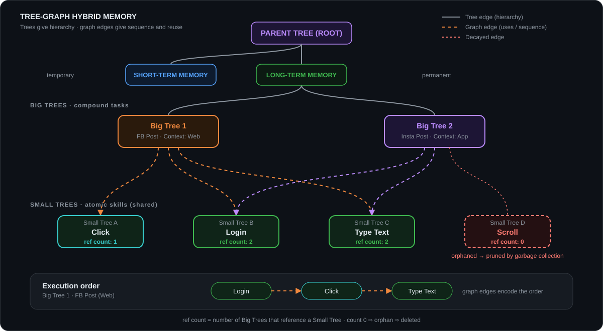

<div align="center">



<br/>

**A bio-inspired, memory-augmented agent that learns UI tasks from screen recordings and keeps what it has learned.**

<br/>


[Overview](#-overview) ·
[Why MEGAMIND](#-why-megamind) ·
[Architecture](#-system-architecture) ·
[Memory Model](#-memory-model) ·
[Growth Gate](#-growth-check-gate) ·
[Pipeline](#-pipeline) ·
[Roadmap](#-roadmap) ·
[Getting Started](#-getting-started) ·
[Evaluation](#-evaluation-plan) ·
[Contributing](#-contributing)

</div>

---

> **Thesis:** *A Bio-Inspired Memory-Augmented Continual Learning System with Dynamic Category Growth.*

## 📖 Overview

**MEGAMIND** is a UI automation agent that learns new tasks by watching screen recordings (**imitation learning**) and accumulates skills over time **without forgetting earlier ones**.

Instead of retraining one large network every time a new task appears, MEGAMIND is inspired by how humans learn. It starts with a minimal base of knowledge and **grows a structured skill memory** as new, repeated behaviour is observed. Skills that stop being useful are gradually pruned, which keeps the agent small enough for edge devices.

<div align="center">

| 👁️ Perception | 🧠 Memory | 🚪 Growth Gate | 🧹 Forgetting |
|:---:|:---:|:---:|:---:|
| Finds *what can be clicked* | Remembers *what to do* | Decides *what is worth remembering* | Drops *what is no longer needed* |

</div>

### At a glance

| | |
|---|---|
| **Goal** | Continual UI-task learning from screen recordings, with no catastrophic forgetting |
| **Core idea** | Grow a *Tree-Graph skill memory* instead of retraining model weights |
| **Perception** | Lightweight object detector (YOLOv8n), later extended with attention |
| **Memory** | Short-Term Memory → Growth-Check Gate → Long-Term Memory |
| **Skill structure** | Big Trees (compound tasks) referencing shared Small Trees (atomic skills) |
| **Forgetting** | Reference counting and time-based decay |
| **Current phase** | Phase 1 · training the visual encoder |

---

## 🎯 Why MEGAMIND

<div align="center">

</div>

<br/>

| # | Problem | How MEGAMIND responds |
|:-:|---------|------------------------|
| 1 | **Catastrophic forgetting.** Conventional models overwrite old skills when trained on new ones, so each update needs expensive retraining. | New skills are **added to memory** as new trees. Existing skills are not overwritten. |
| 2 | **Rigid architectures.** Most UI agents break when a layout changes (for example, a moved button) or when they leave their training scope. | A **task-relevant encoder** looks for buttons and icons instead of memorizing raw pixels, so it is meant to tolerate layout changes. |
| 3 | **Memory bloat.** Continual learners tend to store redundant low-level detail, which makes them too heavy for edge devices. | **Shared Small Trees** avoid duplication, and **garbage collection** prunes unused detail. |

> [!NOTE]
> The chart above is a **conceptual illustration of the design goal**, not an experimental result. Measured results will be added under [Evaluation Plan](#-evaluation-plan) as they become available.

### Design principles

1. **Task-relevant perception.** Attend to meaningful UI elements, not pixels.
2. **Staged memory.** Observations start in Short-Term Memory and are promoted to Long-Term Memory only if they prove reliable.
3. **Evidence-driven growth.** Only cohesive, repeated action clusters are promoted. Noise and one-off mistakes are filtered out.
4. **Strategic selective forgetting.** Unused skills and relations decay and are removed.

---

## 🏗️ System Architecture

<div align="center">

</div>

<br/>

### Component reference

| Component | Role | Status |
|-----------|------|:------:|
| **Parent Tree (Root)** | System base knowledge. Starts minimal and grows dynamically. | Planned |
| **Lightweight Image Encoder** | Detects task-relevant UI features (buttons, icons). Acts as the agent's "visual cortex". | ⏳ In progress |
| **Short-Term Memory (STM)** | Temporary buffer for unconfirmed actions observed in recordings. | Planned |
| **Growth-Check Gate** | Promotes only cohesive, repeated action clusters from STM to LTM. | Planned |
| **Long-Term Memory (LTM)** | Permanent, reusable skills stored as Big Trees and Small Trees joined by graph edges. | Planned |
| **Garbage Collector** | Reference counting and time-based decay prune orphaned skills and weak edges. | Planned |

---

## 🌳 Memory Model

MEGAMIND stores skills in a **Hierarchical Skill Ontology** that combines two structures:

- **Trees** express *hierarchy*: a compound task is built from smaller skills.
- **Graphs** express *sequence and relations*: which skill follows which, and which tasks share skills.

<div align="center">

</div>

<br/>

| Structure | Role | Example |
|-----------|------|---------|
| **Big Tree** | Compound task, tied to a context (Web or App) | FB Post (Web), Insta Post (App) |
| **Small Tree** | Atomic, reusable skill | Login, Click, Type Text |
| **Graph edge** | Sequence and dependency between trees | Login → Click → Type Text |
| **Reference count** | Number of Big Trees that use a Small Tree | `Login = 2`, `Click = 1` |

> [!TIP]
> Small Trees are **shared**. "Login" is stored once and referenced by every task that needs it. This reuse keeps memory compact and avoids duplicated knowledge.

<details>
<summary><b>Proposed data model (design sketch, not yet implemented)</b></summary>

<br/>

```python
from dataclasses import dataclass, field
from typing import Literal

@dataclass
class Action:
    kind: Literal["click", "type", "scroll"]
    target: str            # detected UI element (class + embedding or region id)
    payload: str | None = None

@dataclass
class SmallTree:           # atomic, reusable skill
    id: str
    name: str              # e.g. "login"
    steps: list[Action]
    ref_count: int = 0     # number of Big Trees referencing this skill
    last_used: float = 0.0

@dataclass
class BigTree:             # compound task
    id: str
    name: str              # e.g. "fb_post"
    context: Literal["web", "app"]
    sequence: list[str] = field(default_factory=list)  # ordered Small Tree ids (graph edges)
```

</details>

---

## 🚪 Growth-Check Gate

<div align="center">

</div>

<br/>

The gate sits between STM and LTM and is the main defence against learning noise. An observation is promoted only when it passes all checks.

| Check | Question | Tunable parameter *(proposed)* |
|-------|----------|--------------------------------|
| **Repetition** | Has this action cluster been observed enough times? | `min_repetitions` (N) |
| **Cohesion** | Do the occurrences share ordering, context and target elements? | `cohesion_threshold` |
| **Relevance** | Do the actions involve task-relevant UI elements? | `min_relevant_ratio` |
| **Persistence** | Is the cluster stable over time rather than a one-off burst? | `time_window` |

Observations that fail are either kept in STM for more evidence or discarded when they expire. The exact definitions of *cohesive* and *repeated* are open design questions (see [Open Research Questions](#-open-research-questions)).

---

## 🧹 Forgetting and Pruning

| Mechanism | What it does | Effect |
|-----------|--------------|--------|
| **Reference counting** | Deletes a Small Tree when no Big Tree references it (`count = 0`). | Removes orphaned skills. |
| **Time-based decay** | Weakens graph edges that are not used and removes them when they fall below a threshold. | Keeps the graph sparse and lightweight. |

---

## 🔄 Pipeline

<div align="center">

</div>

<br/>

| Step | Stage | What happens |
|:----:|-------|--------------|
| 1 | **Observe** | The agent watches a screen recording of a user performing a task. |
| 2 | **Perceive** | The encoder extracts task-relevant UI elements from each frame. |
| 3 | **Buffer** | The observed action sequence is written to STM. |
| 4 | **Verify** | The Growth-Check Gate looks for a cohesive, repeated cluster of actions. |
| 5 | **Consolidate** | Verified clusters are promoted to LTM as Small Trees. Big Trees link them through graph edges. |
| 6 | **Reuse** | When a new task shares sub-skills with an old one, existing Small Trees are referenced instead of relearned. |
| 7 | **Prune** | Garbage collection removes orphaned skills and decayed edges. |
| 8 | **Execute** | The agent replays the learned skill across applications. |

---

## 🚀 Roadmap

<div align="center">

</div>

<br/>

### Phase 1 · Base Knowledge Pre-training (Foundation)
- [x] **Step 1 · Data collection.** 100–200 raw screenshots of diverse UI environments, focused on icons, buttons and clickable items.
- [x] **Step 2 · Preprocessing and annotation.** Bounding boxes and labels (`button`, `icon`) created in Roboflow and exported in YOLO format.
- [ ] **Step 3 · Model training** ⏳ *(we are here)*. Train a lightweight detector (YOLOv8n, later an attention encoder) to identify clickable areas regardless of layout changes.

### Phase 2 · Memory Architecture
- [ ] **Step 4 · STM and LTM setup.** Build the short-term and long-term branches under the Parent Tree.
- [ ] **Step 5 · Growth-Check mechanism.** Filter noisy data and promote repeated, cohesive actions to permanent skills.

### Phase 3 · Graph-Tree Integration and Optimization
- [ ] **Step 6 · Big Tree / Small Tree logic.** Map compound tasks to atomic skills using directed graphs.
- [ ] **Step 7 · Garbage collection.** Implement reference counting and memory decay for selective forgetting.
- [ ] **Step 8 · Final agent integration.** Watch a screen recording, extract actions and execute tasks across diverse applications.

---

## 🛠️ Getting Started

> [!IMPORTANT]
> The project is in **Phase 1**. Only the perception module (detector training) is runnable today. Memory components arrive in Phase 2.

### Requirements

| Requirement | Notes |
|-------------|-------|
| Python | A recent Python 3 release supported by Ultralytics |
| Ultralytics | Provides YOLOv8 training, inference and export |
| GPU *(optional)* | Speeds up training. YOLOv8n is small enough for CPU on a dataset of this size, just slower. |
| Dataset | Annotated screenshots in YOLO format (exported from Roboflow) |

### Installation

```bash
# 1. Clone the repository
git clone <repository-url>
cd megamind

# 2. Create an isolated environment
python -m venv .venv
source .venv/bin/activate        # Windows: .venv\Scripts\activate

# 3. Install dependencies
pip install ultralytics
```

### Dataset layout

```text
data/
├── images/
│   ├── train/
│   └── val/
├── labels/
│   ├── train/
│   └── val/
└── data.yaml
```

```yaml
# data/data.yaml
path: data
train: images/train
val: images/val
names:
  0: button
  1: icon
```

### Train the detector

```bash
yolo detect train data=data/data.yaml model=yolov8n.pt epochs=100 imgsz=640
```

### Run inference

```bash
yolo detect predict model=runs/detect/train/weights/best.pt source=screenshots/
```

```python
from ultralytics import YOLO

model = YOLO("runs/detect/train/weights/best.pt")
results = model("screenshot.png")

for r in results:
    for box, cls in zip(r.boxes.xyxy, r.boxes.cls):
        print(model.names[int(cls)], box.tolist())
```

### Export for edge devices

```bash
yolo export model=runs/detect/train/weights/best.pt format=onnx
```

### Detector results

| Metric | Value |
|--------|:-----:|
| mAP@0.5 | _TBD_ |
| Precision | _TBD_ |
| Recall | _TBD_ |
| Model size | _TBD_ |

---

## 📊 Evaluation Plan

Each phase will be evaluated with measurable metrics so that the project's claims can be checked.

| Area | Metric | Phase |
|------|--------|:-----:|
| **Perception** | mAP@0.5, precision and recall on a held-out set, and on unseen layouts and apps | 1 |
| **Forgetting** | Success on old skills after learning new ones (backward transfer) | 2–3 |
| **Reuse** | Improvement on new tasks that share sub-skills (forward transfer) | 3 |
| **Growth-Check quality** | Share of noisy or one-off actions wrongly promoted (false-promotion rate) | 2 |
| **Efficiency** | Memory size (nodes, edges, MB) over time, with and without pruning | 3 |
| **End-to-end** | Task success rate across different apps and after layout changes | 3 |

---

## 🧩 Tech Stack

| Layer | Tool |
|-------|------|
| Annotation | Roboflow |
| Object detection | YOLOv8n (Ultralytics) |
| Deep learning | PyTorch |
| Memory graph | NetworkX *(prototype, to be revisited for scale)* |
| Language | Python |

---

## 🗂️ Planned Repository Structure

> Target layout. Folders will appear as each phase is completed.

```text
megamind/
├── assets/               # Animated SVG diagrams used in this README
├── data/                 # Datasets (raw, annotated, YOLO format)
├── perception/           # Image encoder: training and inference
├── memory/
│   ├── stm.py            # Short-Term Memory
│   ├── ltm.py            # Long-Term Memory (Big/Small Trees, graph)
│   ├── growth_gate.py    # Growth-Check Gate
│   └── gc.py             # Reference counting and decay
├── agent/                # Action extraction and execution
├── eval/                 # Metrics and benchmark scripts
├── docs/                 # Thesis notes
└── README.md
```

---

## 🔬 Open Research Questions

<details>
<summary><b>Design decisions still to be settled as the project moves into Phase 2</b></summary>

<br/>

1. **Growth-Check criteria.** How are "cohesive" and "repeated" defined (similarity metric, minimum repetitions, time window)?
2. **Action representation.** How are clicks, typing and scrolling extracted from raw video and stored in a tree node?
3. **Element identity.** A detector says *where* an element is, but reusing a skill also needs *what it is* (icon semantics, text, or an embedding).
4. **Layout robustness.** How do skills stay valid when a button moves, changes colour or is renamed?
5. **Decay schedule.** How fast should edges decay, and how is useful-but-rare knowledge protected?
6. **Dataset scale.** 100–200 screenshots is a good start for a prototype. Augmentation and more diverse applications will be needed for generalization.
7. **Encoder choice.** Whether to use YOLOv8n alone or add a separate attention module, and how that choice affects model size.

</details>

---

## ❓ FAQ

<details>
<summary><b>How is this different from fine-tuning a model on each new task?</b></summary>

<br/>

Fine-tuning changes shared weights, which can overwrite earlier skills. MEGAMIND keeps perception fixed and stores new skills as separate trees in memory, so adding a skill does not alter existing ones.

</details>

<details>
<summary><b>Why separate Big Trees and Small Trees?</b></summary>

<br/>

Compound tasks (FB Post) are often built from the same atomic skills (Login, Click). Storing atomic skills once and referencing them avoids duplication and makes reuse and pruning straightforward through reference counts.

</details>

<details>
<summary><b>What happens to skills that are rarely used?</b></summary>

<br/>

Unused graph edges decay over time, and Small Trees with a reference count of zero are deleted. Protecting useful-but-rare skills is an open question listed above.

</details>

<details>
<summary><b>Can I run it today?</b></summary>

<br/>

Only the Phase 1 perception module (detector training and inference) is runnable. STM, LTM and the gate are planned for Phase 2.

</details>

---

## 🤝 Contributing

Contributions, ideas and feedback are welcome.

1. Open an issue to discuss a change before starting work.
2. Fork the repository and create a branch such as `feat/growth-gate` or `fix/annotation-labels`.
3. Keep commits focused and use clear messages (for example `feat: add reference counting`).
4. Open a pull request that describes the change and links the related issue.

**Editing diagrams.** The visuals in `assets/` are hand-written, self-contained animated SVGs. Edit them in any text editor and preview them in a browser. No build step is required.

---

## 📄 License and Citation

**License:** _to be decided_.

If you use this work, please cite:

```bibtex
@misc{megamind,
  title  = {MEGAMIND: A Bio-Inspired Memory-Augmented Continual Learning System with Dynamic Category Growth},
  note   = {Thesis project, work in progress},
  year   = {2026}
}
```

---

## 🙏 Acknowledgements

- [Ultralytics](https://github.com/ultralytics/ultralytics) for YOLOv8
- [Roboflow](https://roboflow.com) for annotation tooling

<div align="center">

<sub>MEGAMIND explores how staged memory, consolidation and selective forgetting can help practical UI agents keep learning over their lifetime.</sub>

</div>
